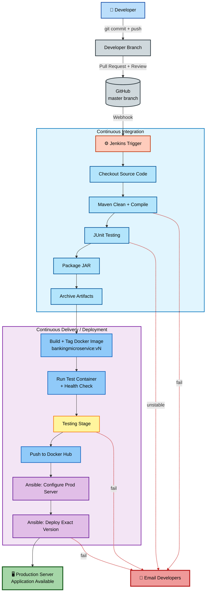
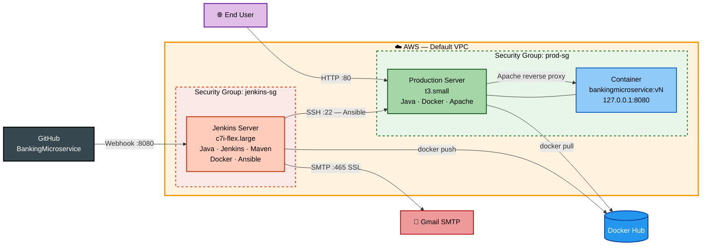
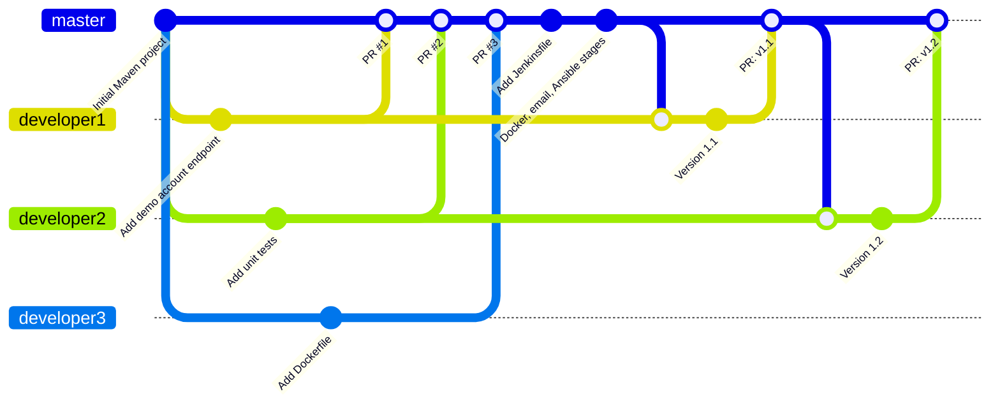
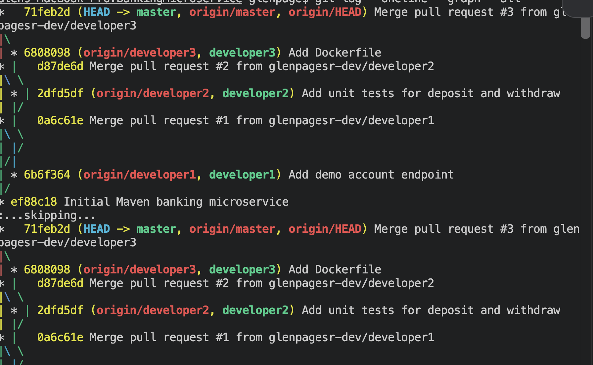
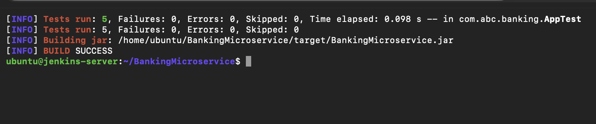
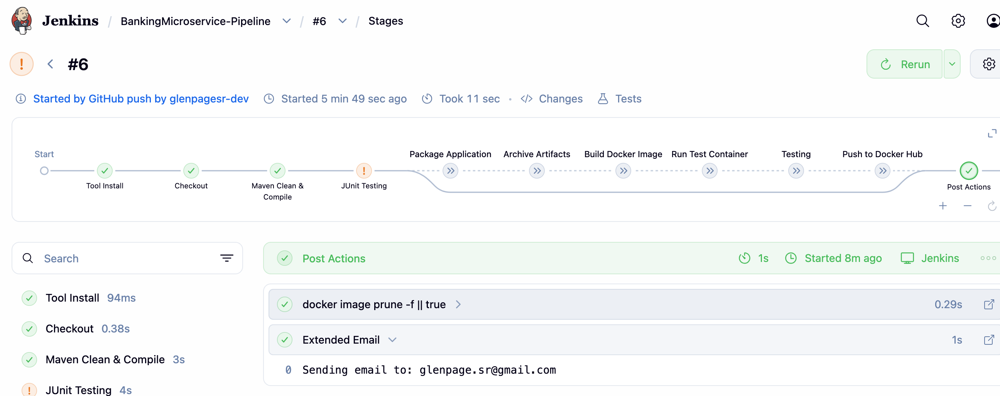
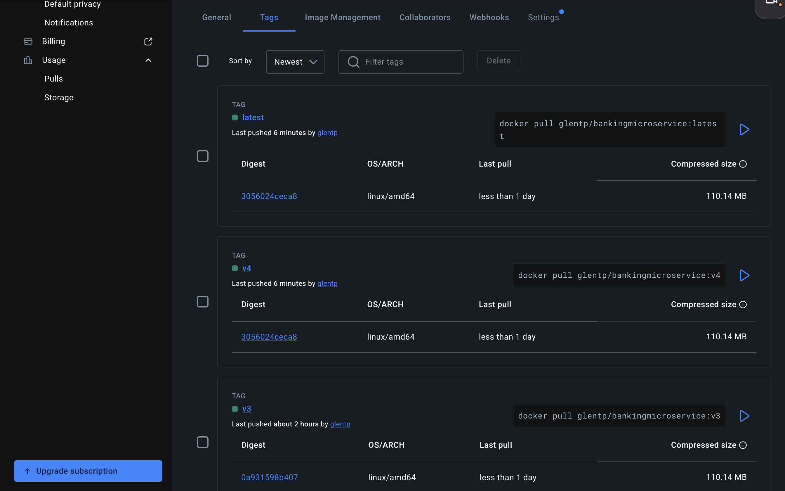
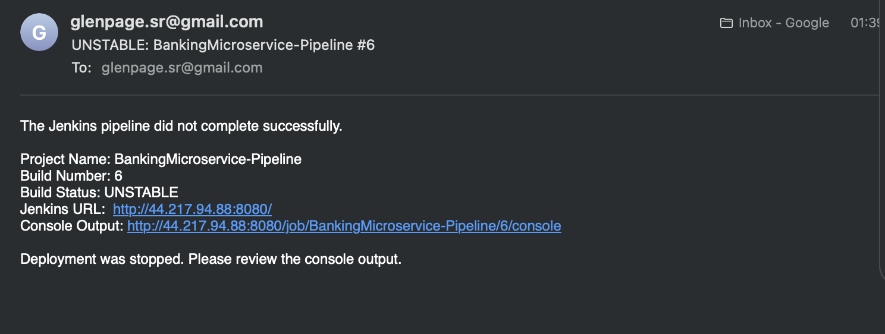
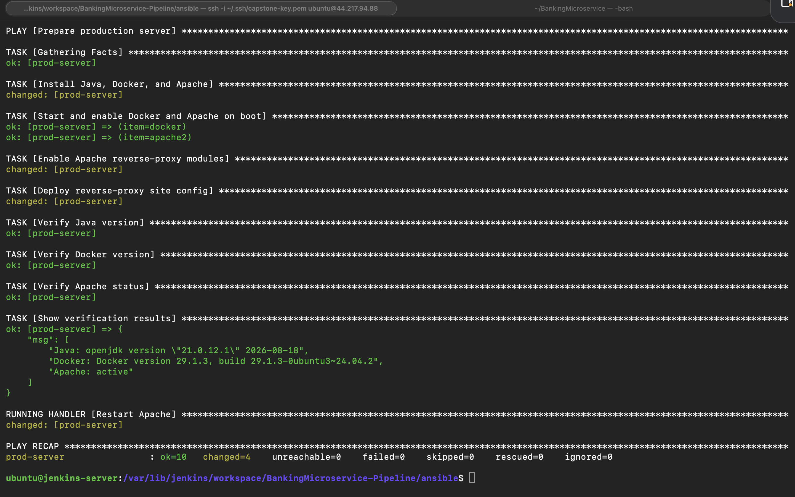

# 🏦 Banking Microservices CI/CD Automation — DevOps Capstone Project


> An end-to-end DevOps capstone project that automates the full software delivery lifecycle for a **Java-based banking microservice** — from a developer's pull request to a running container on a **production Linux server in AWS**, with no manual steps. The pipeline uses **Git & GitHub** for source control, **Jenkins** for CI/CD, **Maven & JUnit** for build and test, **Docker** for versioned images, **Ansible** for configuration management and deployment, and **email notifications** that stop bad builds before they reach production.

---

## 📺 [WATCH ME BUILD THE PROJECT HERE](https://www.loom.com/share/45bd23a4b84b4b42934335dd72f10ecc)

> 🔗 A full walkthrough: infrastructure, pipeline build-out, a deliberate test failure, a live production deployment, and a one-command rollback.

## 📋 Project Overview

| Field | Value |
| --- | --- |
| **Project type** | End-to-End DevOps Implementation (Capstone) |
| **Industry** | Banking & Financial Services |
| **Cloud platform** | AWS — Amazon EC2 (Ubuntu 24.04 LTS) |
| **Core tools** | Git · GitHub · Jenkins · Maven · JUnit · Docker · Docker Hub · Ansible · Apache HTTP Server |
| **Result** | A merged pull request reaches production in **~40 seconds**, fully automated |
| **Time to complete** | ~20 hours across multiple sessions |
| **Estimated cost** | Covered by AWS Free plan credits — **stop instances when idle** and check the [AWS Pricing Calculator](https://calculator.aws/) |
| **Career relevance** | DevOps Engineer · Cloud Engineer · Build & Release Engineer · Site Reliability Engineer |

---

## 🧩 The Business Problem This Project Solves

**ABC Technologies Pvt. Ltd.** develops banking applications for a global banking client. The team follows Agile, but almost every software delivery activity is still done **by hand**. The client is migrating its monolithic application into **Java-based microservices using REST APIs** — and as developers and services multiply, manual delivery has become slow, error-prone, and difficult to manage.

> **Scenario:** Three developers finish their features on the same afternoon. One emails a ZIP file, one pushes straight to `master`, and one asks an operations engineer to "just copy the JAR to the server." The ops engineer builds the image on their own laptop, forgets which version is running in production, and overwrites the working container. The release breaks, there is no record of what changed, and no fast way to roll back. A one-hour release turns into a late-night outage.

### Existing challenges — and how this project solved them

| Challenge | Solution implemented |
| --- | --- |
| Manual code integration from multiple developers | Developer branches + reviewed pull requests into `master` |
| No centralized version control strategy | GitHub repository with a defined branch strategy |
| Manual application builds | Maven builds triggered automatically by a GitHub webhook |
| Manual testing process | JUnit tests run on every pipeline execution |
| Manual Docker image creation | Jenkins builds, health-checks, and tags every image automatically |
| Manual deployment to production | Ansible configures the server and deploys the exact image version |
| No automated rollback or versioning | Every image tagged `v<BUILD_NUMBER>` — rollback is one command |
| Lack of deployment consistency | Same Dockerfile, same playbooks, same steps — every time |
| Increased release time | Merge-to-production in ~40 seconds |
| Higher probability of production errors | Failing tests mark the build **UNSTABLE**, skip deployment, and email developers |

### How this project maps to real roles

| Role | How this project applies |
| --- | --- |
| **DevOps Engineer** | Designing and maintaining the CI/CD pipeline end to end |
| **Build & Release Engineer** | Maven builds, artifact archiving, image versioning, and release tagging |
| **Cloud Engineer** | Provisioning and securing EC2 instances, security groups, and SSH access |
| **Site Reliability Engineer** | Health checks, idempotent configuration, and rollback-ready deployments |

---

## 🎯 What This Project Demonstrates

| Skill | Real-world application |
| --- | --- |
| **Git branching strategy** with pull requests | How engineering teams integrate code from many developers safely |
| **Maven build automation** | Dependency resolution, compilation, testing, and packaging in one repeatable command |
| **JUnit unit testing** in CI | Catching defects before they ever reach a server |
| **Jenkins Pipeline as Code** | A versioned, reviewable `Jenkinsfile` instead of click-configured jobs |
| **Docker image versioning** | Immutable, traceable releases (`v3`, `v4`, … `v11`) |
| **Quality gates** | Unstable builds never reach the registry or production |
| **Ansible configuration management** | Idempotent server setup and repeatable deployments |
| **Automated deployment + rollback** | Zero-touch releases and one-command recovery |
| **Email notifications** | Fast feedback loops so developers fix issues immediately |

---

## 🏗️ Architecture

### Complete CI/CD Pipeline

How a single merged pull request moves from a developer's laptop to production.



### AWS Infrastructure

Two EC2 instances: one CI/CD server and one production server.



### Git Branching Strategy (actual project history)



---

## 📁 Repository Structure

```text
BankingMicroservice/
├── src/
│   ├── main/java/com/abc/banking/
│   │   └── App.java
│   └── test/java/com/abc/banking/
│       └── AppTest.java
├── ansible/
│   ├── ansible.cfg
│   ├── inventory.ini
│   ├── setup-production.yml
│   ├── deploy.yml
│   └── files/
│       └── bankingmicroservice.conf
├── screenshots/
├── .gitignore
├── pom.xml
├── Dockerfile
├── Jenkinsfile
└── README.md
```

> ℹ️ Maven expects source code under `src/main/java/<package>/` and tests under `src/test/java/<package>/`. The capstone brief shows a simplified tree; this is the standard Maven layout.

---

## ✅ Prerequisites

### Accounts

- [ ] **AWS account** with permission to launch EC2 instances, create security groups, key pairs, and Elastic IPs
- [ ] **AWS budget alert** configured (Billing → Budgets) to avoid surprise charges
- [ ] **GitHub account**
- [ ] **Docker Hub account** and a **personal access token** (Read & Write)
- [ ] **Gmail account** with **2-Step Verification** enabled and an **App Password** (for Jenkins email)

### Local workstation

- [ ] **Git** installed and configured (`git config --global user.name` / `user.email`)
- [ ] **SSH client** (Terminal on macOS/Linux, or Windows Terminal / PowerShell OpenSSH)
- [ ] **VS Code** (or similar) for Java, YAML, and Markdown files
- [ ] **Web browser** for the AWS Console, Jenkins UI, GitHub, and Docker Hub

> ℹ️ No Java, Maven, or Docker is needed on the workstation — all builds run on the Jenkins server.

### AWS infrastructure (created in Phase 0)

- [ ] **EC2 key pair** (`.pem`) stored in `~/.ssh` with `chmod 400`
- [ ] **Jenkins server** — Ubuntu Server 24.04 LTS, `c7i-flex.large`, 20 GiB gp3, Elastic IP
- [ ] **Production server** — Ubuntu Server 24.04 LTS, `t3.small`, 15 GiB gp3
- [ ] **Security groups** `jenkins-sg` and `prod-sg`

### Software — Jenkins server

| Software | Version used | Install |
| --- | --- | --- |
| OpenJDK | 21 | `sudo apt install -y openjdk-21-jdk` |
| Maven | 3.8.7 | `sudo apt install -y maven` |
| Git | 2.x | `sudo apt install -y git` |
| Docker Engine | 29.1.3 | `sudo apt install -y docker.io` |
| Ansible | core 2.16.3 | `sudo apt install -y ansible` |
| Jenkins | 2.580.2 LTS | See Phase 3 |

### Software — Production server (installed by Ansible in Phase 7)

| Software | Purpose |
| --- | --- |
| OpenJDK 21 JRE | Java runtime (required by the brief) |
| Docker Engine | Runs the application container |
| Apache HTTP Server | Reverse proxy from port 80 to the container |

### Jenkins plugins

- [ ] Git · GitHub · Pipeline · Maven Integration · JUnit · Email Extension · Credentials Binding · Pipeline Graph View (or Pipeline: Stage View)

### Credentials & secrets

| Item | Stored where |
| --- | --- |
| Docker Hub username + access token | Jenkins Credentials → `dockerhub-creds` |
| Gmail address + App Password | Jenkins Credentials → `gmail-smtp` |
| EC2 private key for the production server | `/var/lib/jenkins/.ssh/prod-key.pem` (`chmod 600`, owner `jenkins`) |

> ⚠️ Never commit keys, tokens, or passwords to GitHub. The project's `.gitignore` excludes `*.pem` and `*.key`.

---

## ☁️ Phase 0 — Provision AWS Infrastructure

### 1. Instances

| Instance | Type | Storage | Purpose |
| --- | --- | --- | --- |
| `jenkins-server` | `c7i-flex.large` (2 vCPU / 4 GiB) | 20 GiB gp3 | Jenkins, Maven, Docker, Ansible |
| `production-server` | `t3.small` (2 vCPU / 2 GiB) | 15 GiB gp3 | Application container behind Apache |

> ℹ️ **Free plan note:** AWS accounts created after July 15, 2025 on the Free plan can launch only free-tier-eligible types (`t3.micro`, `t3.small`, `t4g.micro`, `t4g.small`, `c7i-flex.large`, `m7i-flex.large`). `c7i-flex.large` provides the 4 GiB of memory Jenkins and Maven need.

### 2. Security groups (least privilege)

**`jenkins-sg`**

| Port | Source | Reason |
| --- | --- | --- |
| 22 | My IP | Admin SSH |
| 8080 | My IP | Jenkins UI |
| 8080 | GitHub webhook ranges | GitHub push events |

**`prod-sg`**

| Port | Source | Reason |
| --- | --- | --- |
| 22 | `jenkins-sg` | Ansible SSH from Jenkins only |
| 80 | 0.0.0.0/0 | Public application access through Apache |

> ⚠️ **GitHub webhook IP ranges change.** Always copy the current IPv4 entries from the `"hooks"` list at [api.github.com/meta](https://api.github.com/meta). During this build, GitHub had added `9.234.106.48/28`, `9.234.98.160/28`, and `9.234.98.176/28` to its long-standing ranges (`192.30.252.0/22`, `185.199.108.0/22`, `140.82.112.0/20`, `143.55.64.0/20`). Missing the new ranges caused webhook deliveries to fail with *"failed to connect to host."*

### 3. Elastic IP

Allocate an **Elastic IP** and associate it with `jenkins-server` so the Jenkins URL and GitHub webhook survive restarts.

> ⚠️ **Cost control:** stop both instances when idle. An Elastic IP is billed even while the instance is stopped — release it when the project is finished.

---

## 🌿 Phase 1 — Source Code Management (Git & GitHub)

```bash
git clone https://github.com/glenpagesr-dev/BankingMicroservice.git
cd BankingMicroservice

# One branch per developer
for dev in developer1 developer2 developer3; do
  git checkout -b "$dev" master
  git push -u origin "$dev"
done
git checkout master
```

Each developer commits to their own branch and opens a **pull request** into `master`. After review, the PR is merged and the full history is preserved:

```bash
git --no-pager log --oneline --graph --all
```

| Branch | Change | Merged via |
| --- | --- | --- |
| `developer1` | `/accounts/demo` endpoint | PR #1 |
| `developer2` | JUnit tests for deposit and withdraw | PR #2 |
| `developer3` | Dockerfile | PR #3 |
| `developer1` | Service version 1.1 | Pull request → deployed as `v4`, later `v10` |
| `developer2` | Service version 1.2 | Pull request → deployed as `v11` |

---

## 🔨 Phase 2 — Build Automation (Maven)

### The application

A minimal REST-style service built on Java's built-in HTTP server (no external runtime dependencies):

| Endpoint | Response |
| --- | --- |
| `/` | `Banking Microservice v1.2 is running` |
| `/health` | `{"status":"UP"}` |
| `/accounts/demo` | Sample account summary in JSON |

Money calculations use `BigDecimal` to avoid floating-point rounding errors. The port is configurable through the `PORT` environment variable (default `8080`).

### `pom.xml`

```xml
<?xml version="1.0" encoding="UTF-8"?>
<project xmlns="http://maven.apache.org/POM/4.0.0"
         xmlns:xsi="http://www.w3.org/2001/XMLSchema-instance"
         xsi:schemaLocation="http://maven.apache.org/POM/4.0.0 https://maven.apache.org/xsd/maven-4.0.0.xsd">
  <modelVersion>4.0.0</modelVersion>

  <groupId>com.abc.banking</groupId>
  <artifactId>BankingMicroservice</artifactId>
  <version>1.0</version>
  <packaging>jar</packaging>

  <properties>
    <maven.compiler.release>21</maven.compiler.release>
    <project.build.sourceEncoding>UTF-8</project.build.sourceEncoding>
  </properties>

  <dependencies>
    <dependency>
      <groupId>org.junit.jupiter</groupId>
      <artifactId>junit-jupiter</artifactId>
      <version>5.10.2</version>
      <scope>test</scope>
    </dependency>
  </dependencies>

  <build>
    <finalName>BankingMicroservice</finalName>
    <plugins>
      <plugin>
        <groupId>org.apache.maven.plugins</groupId>
        <artifactId>maven-compiler-plugin</artifactId>
        <version>3.13.0</version>
      </plugin>
      <plugin>
        <groupId>org.apache.maven.plugins</groupId>
        <artifactId>maven-surefire-plugin</artifactId>
        <version>3.2.5</version>
      </plugin>
      <plugin>
        <groupId>org.apache.maven.plugins</groupId>
        <artifactId>maven-jar-plugin</artifactId>
        <version>3.4.1</version>
        <configuration>
          <archive>
            <manifest>
              <mainClass>com.abc.banking.App</mainClass>
            </manifest>
          </archive>
        </configuration>
      </plugin>
    </plugins>
  </build>
</project>
```

| Setting | Why it matters |
| --- | --- |
| `maven.compiler.release` + compiler plugin 3.13.0 | Matches the installed JDK 21 and prevents `release version XX not supported` |
| Surefire 3.2.5 | Required to run JUnit 5 tests (older defaults silently skip them) |
| `junit-jupiter` (test scope) | Downloaded automatically by Maven; never packaged into the JAR |
| `finalName` | Produces `target/BankingMicroservice.jar` exactly as the brief requires |
| `mainClass` | Makes the JAR executable with `java -jar` |

**Result:** `Tests run: 5, Failures: 0` · `BUILD SUCCESS` · `target/BankingMicroservice.jar`

---

## ⚙️ Phase 3 — Continuous Integration (Jenkins)

### Install Jenkins LTS

Jenkins rotated its repository signing key in 2026. Use the current key:

```bash
curl -fsSL https://pkg.jenkins.io/debian-stable/jenkins.io-2026.key | sudo tee \
  /usr/share/keyrings/jenkins-keyring.asc > /dev/null

echo deb [signed-by=/usr/share/keyrings/jenkins-keyring.asc] \
  https://pkg.jenkins.io/debian-stable binary/ | sudo tee \
  /etc/apt/sources.list.d/jenkins.list > /dev/null

sudo apt update
sudo apt install -y jenkins
sudo systemctl enable --now jenkins
```

> ℹ️ Always confirm the current commands at [jenkins.io/doc/book/installing/linux](https://www.jenkins.io/doc/book/installing/linux/).

### Configuration

| Setting | Value |
| --- | --- |
| **Manage Jenkins → Tools → Maven** | Name `Maven3`, MAVEN_HOME `/usr/share/maven`, auto-install **off** |
| **Credentials** | `dockerhub-creds` (Docker Hub token), `gmail-smtp` (Gmail App Password) |
| **Pipeline job** | `BankingMicroservice-Pipeline` → Pipeline script from SCM → `*/master` → `Jenkinsfile` |
| **Trigger** | ☑ GitHub hook trigger for GITScm polling |
| **GitHub webhook** | `http://<JENKINS_PUBLIC_IP>:8080/github-webhook/` → push events |

### Docker access for the `jenkins` user

```bash
sudo usermod -aG docker jenkins
sudo systemctl restart jenkins
sudo -u jenkins docker ps   # must run with no permission error
```

---

## 📜 Phase 3–8 — The Jenkinsfile (Pipeline as Code)

The complete pipeline, versioned in the repository:

```groovy
pipeline {
    agent any

    tools { maven 'Maven3' }

    options {
        skipDefaultCheckout()
        disableConcurrentBuilds()
        buildDiscarder(logRotator(numToKeepStr: '10'))
    }

    triggers { githubPush() }

    environment {
        IMAGE_NAME     = 'glentp/bankingmicroservice'
        IMAGE_TAG      = "v${BUILD_NUMBER}"
        TEST_CONTAINER = 'banking-test'
        DEV_EMAILS     = 'glenpage.sr@gmail.com'
    }

    stages {
        stage('Checkout') {
            steps { checkout scm }
        }
        stage('Maven Clean & Compile') {
            steps { sh 'mvn -B clean compile' }
        }
        stage('JUnit Testing') {
            steps { sh 'mvn -B test -Dmaven.test.failure.ignore=true' }
            post {
                always { junit 'target/surefire-reports/*.xml' }
            }
        }
        stage('Package Application') {
            when { expression { currentBuild.currentResult == 'SUCCESS' } }
            steps { sh 'mvn -B package -DskipTests' }
        }
        stage('Archive Artifacts') {
            when { expression { currentBuild.currentResult == 'SUCCESS' } }
            steps {
                archiveArtifacts artifacts: 'target/BankingMicroservice.jar', fingerprint: true
            }
        }
        stage('Build Docker Image') {
            when { expression { currentBuild.currentResult == 'SUCCESS' } }
            steps {
                sh 'docker build -t $IMAGE_NAME:$IMAGE_TAG -t $IMAGE_NAME:latest .'
            }
        }
        stage('Run Test Container') {
            when { expression { currentBuild.currentResult == 'SUCCESS' } }
            steps {
                sh '''
                    docker rm -f $TEST_CONTAINER || true
                    docker run -d --name $TEST_CONTAINER -p 8081:8080 $IMAGE_NAME:$IMAGE_TAG
                    for i in $(seq 1 15); do
                        if curl -fsS http://localhost:8081/health; then
                            echo ""
                            echo "Health check passed"
                            exit 0
                        fi
                        sleep 2
                    done
                    echo "Health check failed"
                    docker logs $TEST_CONTAINER
                    exit 1
                '''
            }
        }
        stage('Testing') {
            when { expression { currentBuild.currentResult == 'SUCCESS' } }
            steps { echo 'Testing is successful' }
        }
        stage('Push to Docker Hub') {
            when { expression { currentBuild.currentResult == 'SUCCESS' } }
            steps {
                withCredentials([usernamePassword(credentialsId: 'dockerhub-creds',
                                                  usernameVariable: 'DH_USER',
                                                  passwordVariable: 'DH_TOKEN')]) {
                    sh '''
                        echo "$DH_TOKEN" | docker login -u "$DH_USER" --password-stdin
                        docker push $IMAGE_NAME:$IMAGE_TAG
                        docker push $IMAGE_NAME:latest
                        docker logout
                    '''
                }
            }
        }
        stage('Ansible: Configure Production') {
            when { expression { currentBuild.currentResult == 'SUCCESS' } }
            steps {
                dir('ansible') {
                    sh 'ansible-playbook setup-production.yml'
                }
            }
        }
        stage('Deploy to Production') {
            when { expression { currentBuild.currentResult == 'SUCCESS' } }
            steps {
                dir('ansible') {
                    sh 'ansible-playbook deploy.yml -e image=$IMAGE_NAME:$IMAGE_TAG'
                }
            }
        }
    }

    post {
        unsuccessful {
            emailext(
                to: "${DEV_EMAILS}",
                subject: "${currentBuild.currentResult}: ${env.JOB_NAME} #${env.BUILD_NUMBER}",
                body: """The Jenkins pipeline did not complete successfully.

Project Name: ${env.JOB_NAME}
Build Number: ${env.BUILD_NUMBER}
Build Status: ${currentBuild.currentResult}
Jenkins URL:  ${env.JENKINS_URL}
Console Output: ${env.BUILD_URL}console

Deployment was stopped. Please review the console output."""
            )
        }
        fixed {
            emailext(
                to: "${DEV_EMAILS}",
                subject: "FIXED: ${env.JOB_NAME} #${env.BUILD_NUMBER} is back to normal",
                body: """The pipeline is passing again.

Project Name: ${env.JOB_NAME}
Build Number: ${env.BUILD_NUMBER}
Build Status: ${currentBuild.currentResult}
Build URL:    ${env.BUILD_URL}"""
            )
        }
        always {
            sh 'docker image prune -f || true'
        }
    }
}
```

| Design choice | Why |
| --- | --- |
| `disableConcurrentBuilds()` | Queues builds instead of running them in parallel — prevents overlapping deployments and container-name collisions |
| `-Dmaven.test.failure.ignore=true` + `junit` | Records failed tests and marks the build **UNSTABLE** instead of crashing |
| `when { ... == 'SUCCESS' }` | **Quality gate** — unstable or failed builds skip packaging, Docker, push, and deployment |
| `withCredentials` + `--password-stdin` | The Docker Hub token never appears in code, process lists, or logs |
| `deploy.yml -e image=...:vN` | Production runs the **exact** version this build produced, not just `latest` |
| `buildDiscarder` + `docker image prune` | Keeps the Jenkins server's disk from filling up |

---

## 🐳 Phase 4 — Docker Integration

### Dockerfile

```dockerfile
FROM eclipse-temurin:21-jre
WORKDIR /app
COPY target/BankingMicroservice.jar app.jar
EXPOSE 8080
ENTRYPOINT ["java", "-jar", "app.jar"]
```

### Versioning

Every successful build produces a uniquely tagged image from the Jenkins `BUILD_NUMBER`, plus `latest`:

```text
glentp/bankingmicroservice:v3
glentp/bankingmicroservice:v4
...
glentp/bankingmicroservice:v11   ← same digest as :latest
```

The test container is replaced on every build, so only the **latest** image runs. Earlier tags remain in Docker Hub for rollback.

> ℹ️ **v6 and v8 are intentionally missing.** Build #6 failed a unit test and build #8 failed at the image stage, so the pipeline never published them — a broken build cannot reach the registry.

---

## 🧪 Phase 5 — Automated Testing

| Result | Jenkins action |
| --- | --- |
| ✅ Passed | Continue to deployment |
| ⚠️ Unstable (a unit test fails) | Mark build **UNSTABLE**, skip all deployment stages, email developers |
| ❌ Failed (compile error, health check, or any stage) | Mark build **FAILED**, stop pipeline, email developers |

**Demonstrated:** a deliberate failing assertion (`999.00` instead of `150.00`) produced an **UNSTABLE** build #6 with all deployment stages skipped. Reverting it with `git revert` produced a green build #7 and a **FIXED** email.

---

## 📧 Phase 6 — Email Notification

| Setting | Value |
| --- | --- |
| Jenkins Location → System Admin e-mail | Sender address |
| Extended E-mail Notification → SMTP server | `smtp.gmail.com` |
| SMTP Port | `465` with **Use SSL** |
| Credentials | `gmail-smtp` (Gmail address + **App Password**) |

> ⚠️ AWS blocks outbound port **25** from EC2 by default — use **465 (SSL)** or **587 (TLS)**. Gmail rejects normal passwords; an **App Password** is required.

Every failure email includes the **Project Name, Build Number, Build Status, Jenkins URL, and Console Output link**.

---

## 🛡️ Phase 7 — Production Server Preparation (Ansible)

### Key setup on the Jenkins server

```bash
sudo mkdir -p /var/lib/jenkins/.ssh
sudo mv ~/prod-key.pem /var/lib/jenkins/.ssh/prod-key.pem
sudo chown -R jenkins:jenkins /var/lib/jenkins/.ssh
sudo chmod 700 /var/lib/jenkins/.ssh
sudo chmod 600 /var/lib/jenkins/.ssh/prod-key.pem

# First connection records production's host key for verification
sudo -u jenkins ssh -i /var/lib/jenkins/.ssh/prod-key.pem \
  -o StrictHostKeyChecking=accept-new ubuntu@<PROD_PRIVATE_IP> 'hostname'
```

### `ansible/ansible.cfg`

```ini
[defaults]
inventory = inventory.ini
host_key_checking = True
retry_files_enabled = False
```

### `ansible/inventory.ini`

```ini
[production]
prod-server ansible_host=<PROD_PRIVATE_IP> ansible_user=ubuntu ansible_ssh_private_key_file=/var/lib/jenkins/.ssh/prod-key.pem
```

> ℹ️ The **private** IP is used because it never changes on restart, and `prod-sg` only accepts SSH from `jenkins-sg`.

### `ansible/files/bankingmicroservice.conf`

```apache
<VirtualHost *:80>
    ProxyPreserveHost On
    ProxyPass        / http://127.0.0.1:8080/
    ProxyPassReverse / http://127.0.0.1:8080/
</VirtualHost>
```

### `ansible/setup-production.yml`

```yaml
- name: Prepare production server
  hosts: production
  become: true
  tasks:
    - name: Install Java, Docker, and Apache
      ansible.builtin.apt:
        name:
          - openjdk-21-jre-headless
          - docker.io
          - apache2
        state: present
        update_cache: true

    - name: Start and enable Docker and Apache on boot
      ansible.builtin.service:
        name: "{{ item }}"
        state: started
        enabled: true
      loop:
        - docker
        - apache2

    - name: Enable Apache reverse-proxy modules
      ansible.builtin.command: a2enmod proxy proxy_http
      register: a2enmod_result
      changed_when: "'Enabling' in a2enmod_result.stdout"
      notify: Restart Apache

    - name: Deploy reverse-proxy site config
      ansible.builtin.copy:
        src: files/bankingmicroservice.conf
        dest: /etc/apache2/sites-available/000-default.conf
        mode: "0644"
      notify: Restart Apache

    - name: Verify Java version
      ansible.builtin.command: java -version
      register: java_ver
      changed_when: false

    - name: Verify Docker version
      ansible.builtin.command: docker --version
      register: docker_ver
      changed_when: false

    - name: Verify Apache status
      ansible.builtin.command: systemctl is-active apache2
      register: apache_status
      changed_when: false

    - name: Show verification results
      ansible.builtin.debug:
        msg:
          - "Java: {{ java_ver.stderr_lines[0] }}"
          - "Docker: {{ docker_ver.stdout }}"
          - "Apache: {{ apache_status.stdout }}"

  handlers:
    - name: Restart Apache
      ansible.builtin.service:
        name: apache2
        state: restarted
```

### Results

| Run | PLAY RECAP | Meaning |
| --- | --- | --- |
| First run | `ok=10 changed=4 failed=0` | Java 21.0.12.1, Docker 29.1.3, and Apache installed, enabled, and verified |
| Second run | `changed=0 failed=0` | **Idempotent** — nothing changes when the server already matches the playbook |

---

## 🚀 Phase 8 — Production Deployment

### `ansible/deploy.yml`

```yaml
- name: Deploy Banking Microservice
  hosts: production
  become: true
  vars:
    container_name: bankingmicroservice
    image: glentp/bankingmicroservice:latest
  tasks:
    - name: Pull the requested image
      ansible.builtin.command: docker pull {{ image }}
      changed_when: true

    - name: Stop and remove the old container
      ansible.builtin.command: docker rm -f {{ container_name }}
      register: rm_result
      failed_when: false
      changed_when: rm_result.rc == 0

    - name: Run the new container
      ansible.builtin.command: >
        docker run -d --name {{ container_name }}
        --restart unless-stopped
        -p 127.0.0.1:8080:8080
        {{ image }}
      changed_when: true

    - name: Verify the application through Apache
      ansible.builtin.uri:
        url: http://localhost/health
        status_code: 200
        return_content: true
      register: health
      retries: 10
      delay: 3
      until: health.status == 200

    - name: Show health response
      ansible.builtin.debug:
        msg: "Health check: {{ health.content }}"

    - name: Remove unused images
      ansible.builtin.command: docker image prune -f
      changed_when: false
```

| Design choice | Why |
| --- | --- |
| Pull **before** removing the old container | Minimizes downtime to the few seconds it takes to start the new one |
| Bind to `127.0.0.1:8080` | The app is never exposed directly — all traffic goes through Apache on port 80 |
| Health check **through Apache** | Proves the full path works, not just the container |
| `--restart unless-stopped` | The app comes back automatically after a server reboot |

### Rollback

Every image is versioned, so rollback is one command from the Jenkins server:

```bash
cd /var/lib/jenkins/workspace/BankingMicroservice-Pipeline/ansible
sudo -u jenkins ansible-playbook deploy.yml -e image=glentp/bankingmicroservice:v10   # roll back to v1.1
sudo -u jenkins ansible-playbook deploy.yml -e image=glentp/bankingmicroservice:v11   # roll forward to v1.2
```

**Demonstrated:** production rolled back from v1.2 to v1.1 and forward again in about 15 seconds each.

---

## 📈 Pipeline Build History

| Build | Trigger | Result | What it proved |
| --- | --- | --- | --- |
| #1 | Manual | ✅ | First CI run — 5 tests passed, JAR archived |
| #2 | GitHub push | ✅ | Webhook triggers builds automatically |
| #3 | GitHub push | ✅ | First versioned image (`v3`) pushed to Docker Hub |
| #4 | PR merge | ✅ | Service v1.1 → `v4`; `v3` retained for rollback |
| #5 | GitHub push | ✅ | Quality gates and email notifications added |
| #6 | GitHub push | ⚠️ Unstable | Deliberate failing test — deployment skipped, alert emailed, no `v6` published |
| #7 | `git revert` | ✅ | Recovered — **FIXED** email sent |
| #8 | Overlapping run | ❌ | Two builds started in the same minute and collided; resolved by adding `disableConcurrentBuilds()` |
| #9 | Manual | ✅ | Ansible files synced to the Jenkins workspace |
| #10 | GitHub push | ✅ | **First fully automated production deployment** (v1.1) |
| #11 | PR merge | ✅ | **Service v1.2 live in production ~40 seconds after merge** |

---

## 🔒 Security Practices Applied

- **Least-privilege security groups** — Jenkins UI limited to the admin IP and GitHub's published webhook ranges; production SSH accepts connections only from `jenkins-sg`
- **No secrets in code** — Docker Hub token and Gmail App Password stored in the Jenkins credential store and referenced by ID
- **Token masking** — credentials piped through standard input and masked in build logs
- **Host key verification** — `host_key_checking = True` so Ansible verifies the production server's identity
- **Locked-down private key** — `chmod 600`, owned by the `jenkins` user only
- **Internal-only container port** — the application binds to `127.0.0.1`; the public reaches it only through Apache
- **Scoped tokens** — Docker Hub access token instead of the account password; revocable at any time

---

## 🏅 Bonus Tasks

- [x] Jenkinsfile (Pipeline as Code)
- [x] Docker Hub Integration
- [x] GitHub Webhook
- [ ] SonarQube Code Quality Analysis
- [ ] JFrog Artifactory Artifact Repository
- [ ] Blue-Green Deployment
- [ ] Docker Compose
- [ ] Kubernetes Deployment
- [ ] Helm Charts
- [ ] Prometheus Monitoring
- [ ] Grafana Dashboard

---

## 🔭 Production Improvements (Next Steps)

| Improvement | Why |
| --- | --- |
| Run builds on dedicated **Jenkins agents** | Keeps build workloads off the controller |
| **Image vulnerability scanning** (e.g., Trivy) before push | Blocks images with known CVEs |
| **Amazon ECR** with IAM roles | Removes long-lived registry tokens |
| **HTTPS** on Apache with a TLS certificate | Encrypts traffic to the application |
| **Parameterized rollback job** in Jenkins | Audited, one-click rollbacks |
| **Ansible Vault** or AWS Secrets Manager | Centralized secret management |

---

## 💡 DevOps Concepts to Know

| Term | Definition | Where it appears in this project |
| --- | --- | --- |
| **Continuous Integration (CI)** | Automatically building and testing every change merged into the shared branch | Webhook → Maven → JUnit |
| **Continuous Delivery / Deployment (CD)** | Automatically releasing every passing build to an environment | Docker → Docker Hub → Ansible deploy |
| **Quality gate** | A condition a build must pass before moving forward | `when` conditions skip deployment on unstable builds |
| **Artifact** | A versioned, deployable build output | `BankingMicroservice.jar`, Docker images |
| **Immutable image** | An image that is never changed after it is built — a new version gets a new tag | `bankingmicroservice:vN` |
| **Configuration Management** | Defining server state as code so every server is configured the same way | Ansible playbooks |
| **Idempotency** | Running the same automation twice produces the same result with no extra changes | Second playbook run: `changed=0` |
| **Webhook** | An HTTP callback GitHub sends to Jenkins when code is pushed | GitHub → `/github-webhook/` |
| **Rollback** | Returning production to a known-good previous version | Redeploying `v10` |

---

## 🧰 Troubleshooting — Real Issues Solved During This Build

| Symptom | Root cause | Fix |
| --- | --- | --- |
| `t3.medium` not available on the AWS Free plan | Free-plan accounts are limited to free-tier-eligible types | Used `c7i-flex.large` (same 4 GiB memory) |
| GitHub webhook: *"failed to connect to host"* | GitHub added new webhook IP ranges not in the security group | Allow-listed the current `"hooks"` ranges from `api.github.com/meta` |
| Two builds failed while running at the same time | Parallel builds collided on the shared test container and port | Added `disableConcurrentBuilds()` |
| `git push` rejected: *"push declined due to email privacy restrictions"* | Commit email conflicted with GitHub's email privacy setting | Used the GitHub noreply address or updated email privacy settings |
| Commit failed: *"no changes added to commit"* | File edited but never staged | Run `git add` before `git commit` |
| Duplicate folder appeared in VS Code | Copied path included leading spaces | Created files with `touch` from the terminal |
| SSH command began with `00~` / ended with `01~` | Terminal left in bracketed-paste mode after a dropped session | Ran `reset` or opened a new terminal tab |
| `BUILD FAILURE` with no `pom.xml` | Maven was run from the home directory | `cd BankingMicroservice` before `mvn` |
| `release version XX not supported` | `maven.compiler.release` didn't match the JDK | Pinned the compiler plugin and set release to `21` |
| `permission denied ... docker.sock` | The `jenkins` user wasn't in the `docker` group | `usermod -aG docker jenkins` and restart Jenkins |
| Emails never arrive from EC2 | Port 25 blocked by AWS; normal Gmail password rejected | Port 465 with SSL and a Gmail **App Password** |

---

## 📸 Portfolio Evidence

> Screenshots are stored in the `/screenshots` folder. Each section explains what the artifact proves and why it matters in an enterprise environment.

### 1. GitHub Branch Strategy & Commit History



Demonstrates **source control discipline** — independent developer branches, reviewed pull requests, and a complete audit trail of every change merged into `master`.

### 2. Maven Build & JUnit Results



Demonstrates **build automation** — dependencies resolved, code compiled, 5 tests executed, and `BankingMicroservice.jar` produced with zero manual steps.

### 3. Jenkins Pipeline Stage View



Demonstrates **continuous integration and delivery** — every stage from checkout to production deployment, triggered automatically by a GitHub push, with failures stopping the pipeline before they reach production.

### 4. Versioned Docker Images



Demonstrates **release versioning** — each build produces a uniquely tagged image in Docker Hub, enabling traceability and rollback. `v6` is intentionally missing: that build failed a unit test, so the pipeline never published it.

### 5. Failure Email Notification



Demonstrates **fast feedback** — developers receive the project name, build number, status, Jenkins URL, and console link the moment a build fails or becomes unstable.

### 6. Ansible Playbook Run



Demonstrates **configuration management** — Java, Docker, and Apache installed, started, enabled on boot, and verified on the production server automatically. A second run reports `changed=0`, proving the playbook is **idempotent**.

### 7. Application Running in Production


Demonstrates **automated deployment** — the latest container (`v11`) running on the production EC2 instance and reachable through Apache on port 80. The container is bound to `127.0.0.1`, so all public traffic must go through Apache.

### 8. One-Command Rollback


Demonstrates **recoverability** — production rolled back from v1.2 to v1.1 by redeploying a previous image tag with the same playbook.

---

## 🛠️ Tools & Technologies


- **Git & GitHub** — version control, branching, pull requests, webhooks
- **Maven & JUnit** — build automation and unit testing
- **Jenkins** — CI/CD orchestration with a declarative Jenkinsfile
- **Docker & Docker Hub** — containerization and versioned image registry
- **Ansible** — production server configuration and deployment
- **Apache HTTP Server** — reverse proxy in front of the application container
- **AWS EC2** — Jenkins and production server hosting

---

## 🔗 Related Projects

- [ServiceNow ITSM](https://github.com/glenpagesr-dev/Servicenow-ITSM) — incident, change, and service catalogue management
- [More projects on GitHub](https://github.com/glenpagesr-dev) — Azure, Linux, and infrastructure projects

---

## 👤 Author

**Glen Page** — CompTIA Security+ certified, building toward a DevOps Engineer role, with hands-on Microsoft Azure experience and CI/CD pipeline project work using Jenkins, Docker, and Ansible.

- GitHub: [@glenpagesr-dev](https://github.com/glenpagesr-dev)
- LinkedIn: [glen-page-862730246](https://www.linkedin.com/in/glen-page-862730246)

---

> ℹ️ **Note:** This capstone project is built for learning and portfolio purposes. **ABC Technologies Pvt. Ltd.** and its banking client are a fictional case study. All infrastructure ran in a personal AWS account and was shut down after the project. Replace placeholders such as `<JENKINS_PUBLIC_IP>` and `<PROD_PRIVATE_IP>` with your own values.
